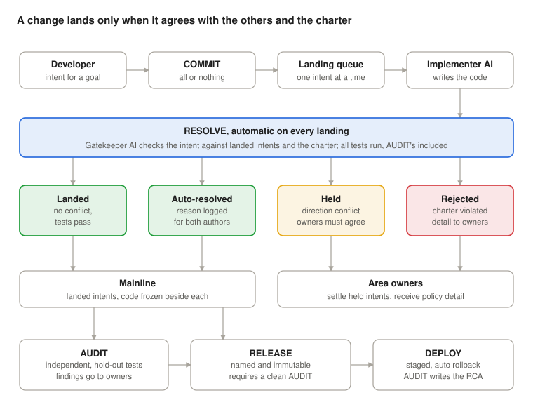

# Luke: From Need to Production

Specification, October 2026.

## Principles

Luke is a new way to build and deliver software, with full traceability. Developers state intents that serve goals, AI writes the code, and a change lands only when it agrees with the rest of the system and with its charter. Every change in production traces back to the need that asked for it.

**Luke's own goal:** every change in production traceable from the need that asked for it to the proof that it works, with no lost work, no merge hell, and no source control expertise required. Every part of this spec has to serve it.

1. **Intent, not code.** Developers describe a change in plain language and the AI implements it. Nobody edits the code base by hand.
2. **No orphan intents.** Every intent serves a named goal set by the product owner. A developer left alone invents frameworks; a goal ties every change to a real need.
3. **Nothing is ever destroyed.** Work in progress is persisted continuously, and every landed, reverted or rejected intent stays retrievable.
4. **The engine stays hidden.** Queues, charters, checkers and storage are internals. Users see only the verbs, the way a SQL user sees SELECT and never the lock manager.
5. **When unsure, reject.** A wrong rejection costs a delay. A wrong acceptance bends someone's intent, or ships fraud.
6. **AI changes production; humans can always stop it.**
    - **Change authority:** AI only. No human pushes a change around the pipeline.
    - **Stop authority:** human and unconditional. Any owner can halt a rollout, freeze deploys or force a rollback, with no AI approval, because a stop is always bounded and recoverable. Stop is a control, not a verb: it changes nothing, it only halts.
    - **Explainability:** every change comes with an explanation its owners can evaluate: what it does, why, the risk and the rollback. A change that can't be explained in those terms doesn't deploy.
    - **Break-glass:** if the AI path is down, a logged human emergency path exists. Every use is audited and converted into an intent afterward.
7. **No eighth verb.** A verb is added only when a job cannot be expressed with the existing seven.

## Concepts

The verbs act on these terms.

| Term | Meaning |
| --- | --- |
| Goal | What is needed, for whom, and its acceptance criteria, written by the product owner. Every intent serves one. |
| Intent | A change stated in plain language, plus the code the AI generated for it. The intent is the record of why; the code is the frozen result. |
| Mainline | The single current state of the software. Intents are applied to it one at a time. |
| Landing queue | The ordered line of committed intents waiting for RESOLVE. |
| Area | A part of the system with its own charter and its own named owners. |
| Charter | One .md file per area stating its purpose and invariants. Every change is checked against it. |
| Owners | The named humans of an area. They approve charter changes, receive policy rejections and audit findings, and settle held intents by consensus. |
| Product owner | Writes goals and their acceptance criteria, and accepts each release. |

## The seven verbs

Seven verbs cover the whole life of a change, from stating it to running it in production. Like INSERT, SELECT, UPDATE and DELETE, each says what the user wants, never how the engine does it.

### COMMIT

Declares an intent finished and hands it to the landing queue. COMMIT carries its SQL meaning: complete, permanent, all or nothing.

- **Used by:** developers.
- **Requires:** a named goal. No orphan intents: a COMMIT that names no goal is refused before it reaches the queue.
- **Triggers:** RESOLVE.
- **Preview:** until COMMIT, RESOLVE runs continuously in report-only mode and shows what would happen if the intent were committed now: conflicts, failing tests, charter issues. Every uncommitted intent is therefore a what-if; abandoning one is simply not committing it, and it stays parked.
- **Plain language:** the developer can say "looks good, ship it". The AI maps that to COMMIT and confirms in one line first, because COMMIT is final.
- **Guarantees:** the intent lands whole or is rejected whole.
- **Never:** a checkpoint. There is no SAVE verb; work in progress, including the conversation with the AI, is persisted continuously.

### REVERT

Undoes a landed intent. A revert is itself an intent ("undo #12") and goes through RESOLVE like any other.

- **Used by:** developers.
- **Guarantees:** if later intents depend on the one being reverted, RESOLVE catches it and either adapts them or rejects the revert, with the reason logged.
- **Never:** deletes history. The reverted intent and its code stay on record.

### BRANCH

Creates a durable variant of the software for one customer or use case, with an owner who intends to keep it. A branch is an overlay, not a fork: mainline plus a standing set of intents specific to that customer.

- **Used by:** developers, naming the branch owner and the reason (for example "customer X" or "the offline variant").
- **Configuration first:** at BRANCH time, the AI checks whether the difference is really a setting. If it is, the change goes on mainline behind configuration and no branch is created.
- **Tracks mainline:** every mainline landing is re-applied onto every branch by the AI, and conflicts go to the branch owner. A branch never drifts, because it never stops tracking mainline.
- **Charter:** inherited from mainline. A branch can add invariants for its customer but never relax mainline's; otherwise BRANCH becomes the way around the charter.
- **Promotion and retirement:** a branch intent that proves good for everyone can be committed to mainline. A retired branch is parked, never deleted.
- **Never:** merges. Work moves between mainline and a branch only as intents through RESOLVE.

### RESOLVE

Runs automatically on every landing; nobody types it. It applies the intent to the current mainline, then checks it against the intents already landed, the area's charter, the implementer's own tests and AUDIT's hold-out tests. Each intent ends in one of four outcomes:

1. **Landed:** no conflict, tests pass.
2. **Auto-resolved:** a conflict the engine could settle, such as the target code having moved into a new method. The intent lands, and the reason is logged for both authors.
3. **Held:** the intents disagree on where the software should go. The intent waits until the area's owners reach consensus, and the author is told why.
4. **Rejected:** the change violates the charter. Full detail goes to the area's owners, not to the author, so a rejection never teaches the next attempt.

- **Guarantees:** held and rejected intents are parked, never deleted. When unsure whether a conflict can be settled, RESOLVE holds.
- **Proportionality:** the gatekeeper checks whether the change does more than its goal requires: a new layer, a new library, a generic engine built for one use case. Anything excessive is held for the owners. This applies to the implementer AI as much as to developers, since AI left alone over-engineers too.
- **Hold-out tests stay hidden:** when an AUDIT test fails, the implementer gets the failure report (which criterion failed and what the system actually did), never the test code.
- **Never:** bends an intent silently.

### RELEASE

Cuts a named, immutable release from mainline.

- **Used by:** release owners.
- **Requires:** a clean AUDIT covering everything landed since the previous release, and the product owner's acceptance.
- **Never:** changes after it is cut. A fix is a new intent and a new release.

### DEPLOY

Puts a release into production in stages, with automatic rollback. Breaks in production are inevitable; the goal is that each one happens once, at small scale, and leaves a fix behind.

- **Used by:** release owners.
- **Staged:** each release reaches a small slice of production first and widens stage by stage. The health checks for each stage are set by the area's owners in the charter, never by the implementer.
- **Automatic rollback:** a failed health check redeploys the previous release at once. No hot fix, and no human needed for the rollback itself.
- **RCA:** AUDIT investigates every rollback and gives the owners a full root cause analysis. The fix comes as a proposed intent that goes through COMMIT like any other, plus a new hold-out test, so the same failure cannot ship twice.
- **Rollback-safe data:** a release's schema and data changes must still work with the previous release; otherwise the rollback breaks too.
- **Never:** deploys raw mainline, or a release that failed AUDIT.

### AUDIT

A reserved verb. An independent AI verifies the work, as the third line of defence after the implementer's own tests and the RESOLVE gatekeeper. AUDIT also takes over the QA function: no human team tests releases by hand, and the people who did become auditors and charter owners.

- **Used by:** auditors only. A developer can request an audit, anonymously, but cannot run it, scope it or read its findings. This separation is what keeps audit outcomes independent, and it is not negotiable:
    - A developer who could run an audit would run it when it is safe to.
    - One who could scope it would steer it away from his own work.
    - One who could read its findings would learn exactly what the auditor looks for, and work around it next time.
    - The request is anonymous so that raising a concern costs the requester nothing, even when it points at a colleague or a superior.
- **Writes the hold-out tests:** from the charter and the acceptance criteria of each intent's goal, written by the product owner, never from the code. RESOLVE runs them on every landing. The implementer never sees them, so it cannot teach to the exam.
- **Runs:** a full audit on a schedule, before every RELEASE, after every production rollback (to write the RCA), and on request. Mutation testing runs on the same schedule, proving that both sets of tests still catch deliberately broken code.
- **Examines:** the cumulative effect of the intent history, every charter change and who approved it, a sample of past auto-resolutions re-judged cold, and drift between what intents asked for and what the code does now.
- **Guarantees:** runs on a different model family from the implementer and the gatekeeper, from a different vendor where possible; sees the artifacts only, never the other AIs' reasoning; findings go to the area's owners.
- **Never:** touches production code or approves anything. It writes only tests and findings, and both stay out of reach of developers and the implementer.

## Roles

Verbs carry privileges, so the verb set is also the permission model.

| Verb | Developer | Release owner | Auditor | Engine |
| --- | --- | --- | --- | --- |
| COMMIT | Yes | | | |
| REVERT | Yes | | | |
| BRANCH | Yes | | | Re-applies every mainline landing |
| RESOLVE | | | | On every landing |
| RELEASE | | Yes | | |
| DEPLOY | | Yes | | |
| AUDIT | Request only | | Yes | Runs AUDIT's tests on every landing; full audit on schedule and before every RELEASE |

Product owners use no verb. They write goals and acceptance criteria, which sit above the verbs the way the charter sits beside them, and they accept each release.

Two separation rules close the loop:

- Auditors do not submit intents in the areas they audit, and every AUDIT run goes into an append-only log the other auditors can see.
- The audit configuration (schedule, scope, model) changes only with approval from two named owners of the area, the same rule as the charter. An audit that never runs produces no findings, which looks exactly like a clean system.

## The charter

Each area has one charter: a short .md file stating its purpose and the invariants the engine enforces on every landing, on code and config alike. Invariants are what make the reality check work: an intent can be worded innocently, but the system that results from it must still satisfy them.

A charter holds four things:

- **Purpose:** one line on what the area is for.
- **Invariants:** rules the system must satisfy at all times, such as where data may go, what may never be lost or altered, and which outside systems it may talk to.
- **Dependencies:** every third-party component in a release is recorded and passes AUDIT.
- **Change rule:** the charter itself changes only with approval from two named owners.

- **Two owners to change it.** The charter is the first thing an insider would try to edit, so no single person can.
- **Dependencies, not languages.** No human picks the language or the libraries; the engine does. The charter controls what a release may depend on, so nothing enters unseen.
- **Testable invariants are tested.** An invariant such as "no record is ever lost" becomes a property-based test, not an AI opinion: feed the system any mix of inputs and failures, and the property must hold. The AI's check is judgment; a passing test is proof.
- **Judged on the result, not the wording.** The gatekeeper evaluates the system after each landing. An insider who adds a harmless-looking "archive copy" feature in one intent, then an outside archive address in a later config change, still breaks the invariant on where data may go.

## One-way code

No human chooses the programming language. The product owner states goals, developers state intents, and the engine decides how to implement them; nobody tells the AI which language to use or avoid. What leaves the engine is a low-level, portable, assembly-like form, compiled one way from intent. WebAssembly is an existing example of such a target.

- **Intent in, low-level code out.** The released code carries no names, comments or structure that lead back to the intents. The intent log never ships.
- **What one-way means.** Any executable can be disassembled, so the code can always be read at machine level. What cannot be recovered is the intent: why the code exists and how it was designed. That lives only in the intent log, which is the real intellectual property.
- **Inside the engine.** The implementer may keep whatever working form it needs to change the code efficiently. That form is an engine internal, never part of a release, and protected like the intent log.
- **Verification is unaffected.** Hold-out tests, AUDIT and RCAs work on intents and behavior, not on readable source. Explainability applies to the intent, not to the code.
- **A dial, not a dogma.** One-way code protects intellectual property for now. Owners can relax it per area as the techniques become public knowledge, and certified areas turn it off toward the certification authority (see Certification).

## Certification

Neither a decompiler nor the intent alone satisfies DO-178C, or DO-278A, its counterpart for ground CNS/ATM systems. A certified area hands the certification authority a complete package under confidentiality, while public releases stay one-way.

- **Why not a decompiler.** Decompiled code carries no link back to the requirements, so it cannot show traceability, and certifying a reconstruction means certifying something nobody designed. The decompiler would also become a tool needing qualification itself.
- **Why not the intent alone.** Intents are requirements. DO-178C also expects reviewed source code, bidirectional trace links, requirements-based tests and structural coverage. Releasing the intent is necessary but not sufficient.
- **The implementer AI is an unqualified tool, so its output is verified.** DO-330 requires qualifying any tool that eliminates, reduces or automates a DO-178C process unless its output is verified ([AFuzion](https://afuzion.com/do-330-introduction-tool-qualification/)). A code generator used for Level A software needs TQL-1, the most demanding level ([Embedded Computing Design](https://embeddedcomputing.com/technology/software-and-os/simulation-modeling-tools/building-trust-in-a-model-based-automatic-code-generator)). A non-deterministic AI cannot be qualified that way today, so Luke verifies its output as if a human had written it.
- **AUDIT is a verification tool.** It could fail to detect an error, which makes its qualification lighter than a code generator's but not zero. Until an authority accepts it, humans review AUDIT's results in certified areas.

| DO-178C expects | Luke provides | Gap to close |
| --- | --- | --- |
| High-level requirements | Goals and their acceptance criteria | Written to a requirements standard: precise and verifiable |
| Low-level requirements | Intents | Same standard as goals |
| Reviewed source code | The engine's working form | Must be a reviewable language. In certified areas the charter names it, the one exception to "no human chooses the language" |
| Bidirectional traceability | Intent log linking goal, intent, code and test | Trace links recorded down to code regions, not only per intent |
| Requirements-based tests | Hold-out tests from acceptance criteria | Fits as is |
| Structural coverage (MC/DC at Level A) | Not yet | AUDIT measures coverage on every release |
| Verification independence | AUDIT on a different model family | Credit needs human review or a qualified tool |
| Configuration management | Intent log and immutable releases | Fits as is |
| Code generator qualification (DO-330) | The implementer AI | Not qualifiable today; output verified instead |

The structure already fits: goals, intents, hold-out tests and AUDIT are requirements, traceability and independent verification under other names. The work is in the gaps: code-level trace links, structural coverage, and human review wherever the authority requires it.

## Getting there: phasing out the human merge

Most agent pipelines today still end with a human approving every merge. At AI output volume that step turns into rubber-stamping: approving what nobody can realistically review, and lending it false assurance. Luke removes per-change human approval by evidence, not by belief.

1. **Auto-merge low-risk classes first.** Dependency updates, documentation, test-only changes, config within charter bounds, and features behind a flag that is off by default. Everything else keeps the human merge for now.
2. **Measure what the human actually catches.** Track how often the human merge rejects or changes anything, and compare escaped defects and rollbacks between auto-merged and human-merged changes. If humans approve almost everything unchanged, the step is ceremony.
3. **Expand class by class while the numbers hold.** Humans move up to release acceptance and sampled audits of past changes.
4. **End state: no per-change human gate.** Humans own goals and charters, accept releases, and keep the stop button.

Two exceptions shape the path:

- **Certified software** keeps human sign-off for as long as the certification authority requires it.
- **Compliance frameworks** that require approval by someone other than the author must be shown that a human-approved goal plus an independent audit meets the rule. That is argued with each auditor, not assumed.

## Engine internals

The engine lands intents one at a time, keeps each intent with its code, and runs three independent checks. Users see none of it; that is what lets seven verbs stay seven.

Only landed and auto-resolved intents reach mainline; held and rejected ones go to the area's owners, and nothing is released without a clean AUDIT.

- **No textual merge, ever.** Intents can be drafted in parallel but land one at a time. If A lands first, B is re-implemented on top of A, which is cheap for an AI. What remains is the only question that matters: does B still make sense now that A exists?
- **Intent log plus frozen code.** The intent log is the authoritative record, like an event stream. The generated code is stored beside each intent, because an AI given the same intent twice writes different code, so replaying intents would not reproduce the system.
- **Three independent checks.** The tests give proof: the implementer's own, plus AUDIT's hold-out tests, which the implementer never sees. The gatekeeper AI inside RESOLVE checks conflicts and the charter. AUDIT re-checks across time on a different model family. The implementer and the gatekeeper share no context, so an intent crafted to steer one does not steer the other.
- **Ask, don't guess.** When an intent is ambiguous, the implementer asks its author instead of filling the gaps.
